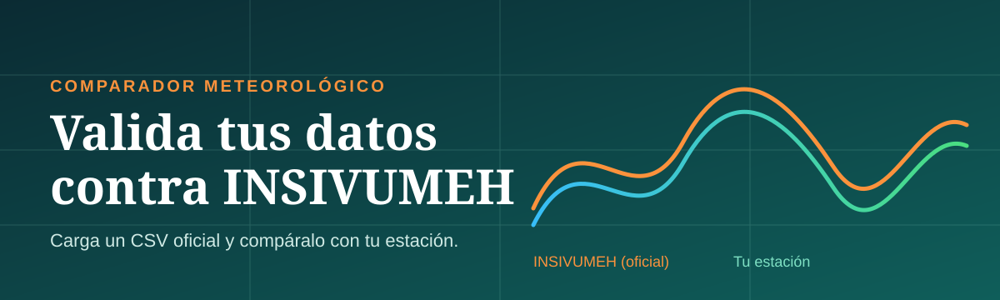
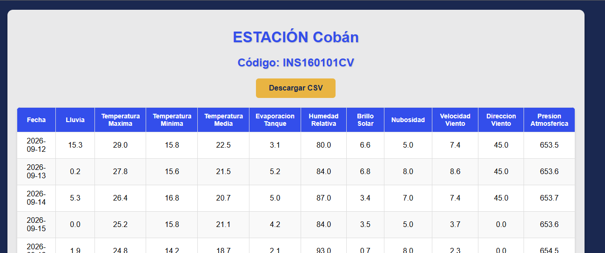
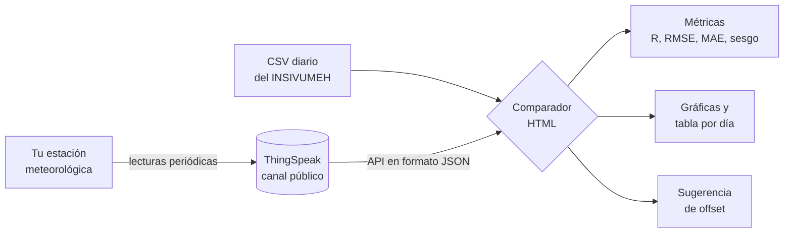
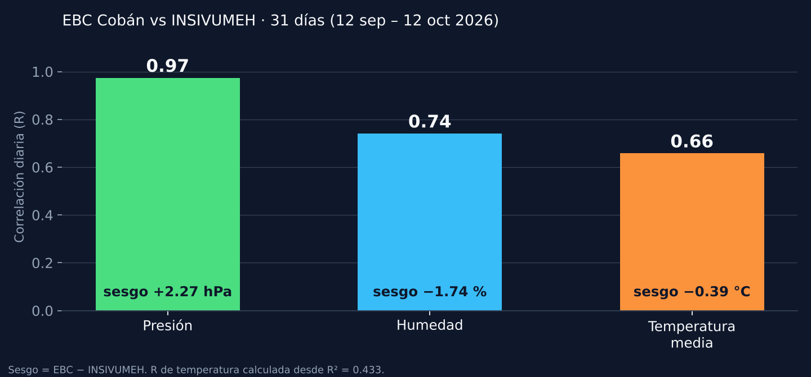
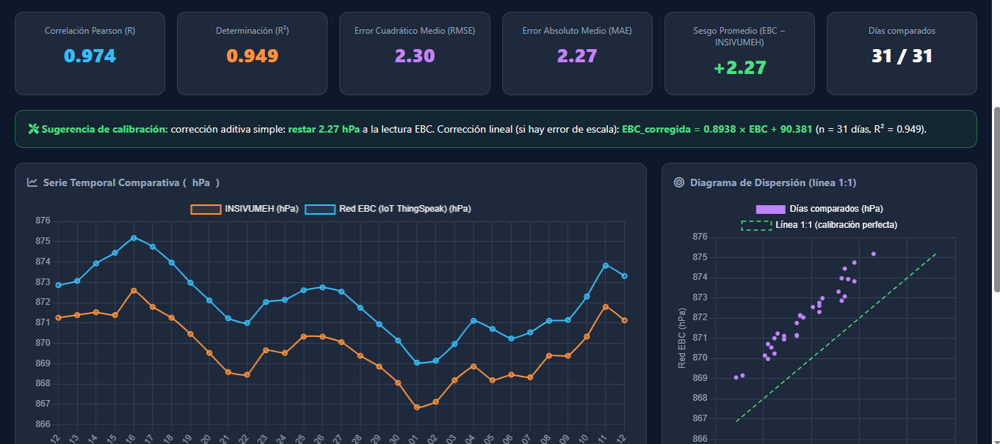
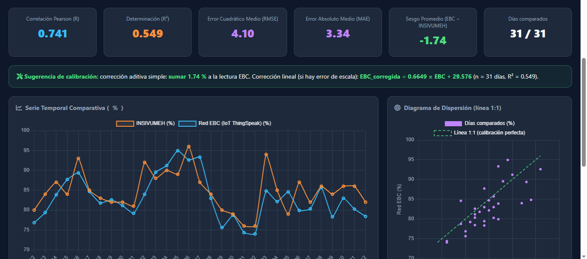
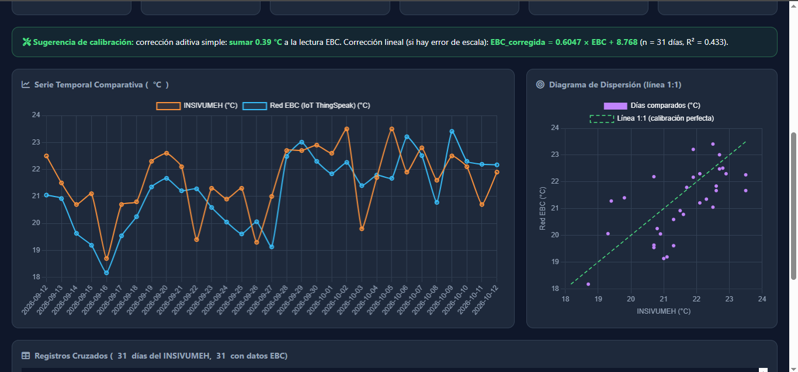

  

  
  
  

<h3 align="center">Compara los datos de tu estación meteorológica con los de una estación oficial del INSIVUMEH. Sin instalar nada. Sin programar. Solo un archivo CSV.</h3>

---

## Menú

<table align="center">
  <tr>
    <td align="center" width="20%"><a href="#-prueba-el-comparador-en-3-minutos"><b>🚀 Probar</b> en 3 minutos</a></td>
    <td align="center" width="20%"><a href="#-por-qué-existe-este-comparador"><b>🎯 Por qué existe</b> la necesidad</a></td>
    <td align="center" width="20%"><a href="#-ejemplo-de-resultados-estación-cobán"><b>📊 Ejemplo</b> Cobán, 31 días</a></td>
    <td align="center" width="20%"><a href="#-cómo-leer-las-métricas"><b>📐 Métricas</b> qué significan</a></td>
    <td align="center" width="20%"><a href="#-preguntas-frecuentes"><b>❓ Preguntas</b> frecuentes</a></td>
  </tr>
</table>

  
  &nbsp;
  

<!-- Cuando publiques el comparador con GitHub Pages, cambia el primer enlace por la URL pública de la página. -->

---

## 🎯 Por qué existe este comparador

Quien opera su propia estación meteorológica, sea de bajo costo (por ejemplo ESP32 + BME280) o de otro tipo, necesita saber qué tan cerca están sus datos de los oficiales.

Para saberlo hay que compararlos con una estación oficial, y ahí aparece el problema:

| Sin el comparador | Con el comparador |
|---|---|
| El INSIVUMEH no ofrece una API pública. | Basta con el CSV que ya publican en su página. |
| Cruzar fechas, convertir unidades (la presión viene en **mmHg**) y promediar cientos de lecturas por día se hace a mano en una hoja de cálculo. | El cruce, las conversiones y los promedios son automáticos. |
| Cuesta distinguir si una diferencia viene del sensor o de cómo se hace la comparación. | Muestra sesgo, error y correlación por variable, con una sugerencia de ajuste. |
| Un tercero no puede revisar de dónde salieron las cifras. | Cualquiera puede descargar los datos crudos de ambas fuentes y verificarlos. |

> **Importante:** la estación del INSIVUMEH es la referencia de comparación, no la verdad absoluta. El comparador muestra *qué tan cerca* están tus datos de los oficiales; no certifica ninguna estación.

---

## 🚀 Prueba el comparador en 3 minutos

Necesitas un navegador (Chrome, Edge o Firefox) y conexión a internet. No hay que instalar nada ni crear cuentas.

**1. Descarga el CSV del INSIVUMEH**

Abre la página de la estación de Cobán y pulsa **Descargar CSV**:

👉 **<https://insivumeh.gob.gt/img/Estaciones_Met/output_dashboard/INS160101CV.html>**

  

**2. Abre el comparador**

Abre [`https://kuckling.github.io/comparador-EBC_Kuckling-Insivumeh/`] en tu navegador.

**3. Carga el CSV**

En la tarjeta **"2. Cargar CSV del INSIVUMEH"** elige el archivo que descargaste. El comparador lee las fechas del archivo y descarga de ThingSpeak solo ese rango, sin que tengas que indicar nada más. Debajo del selector verás qué columna usó para cada variable, para que puedas confirmarlo.

**4. Elige la estación y la variable**

- **Estación EBC:** Cobán, Gualán o El Teocinte. Al elegirla se rellena el canal de ThingSpeak correspondiente. Para comparar contra el CSV de Cobán, deja **Cobán**.
- **Variable a analizar:** temperatura media, máxima o mínima, humedad o presión.

**5. Lee los resultados**

Aparecen las métricas, la sugerencia de calibración, la serie temporal, el diagrama de dispersión con la línea 1:1 y la tabla día por día.

### Botones útiles

| Botón | Qué hace |
|---|---|
| **Crudo INSIVUMEH (.csv)** | Descarga los datos del INSIVUMEH tal como se leyeron (la presión sin convertir, en mmHg). |
| **Crudo ThingSpeak API (.csv)** | Descarga todas las lecturas de la estación usadas en el análisis. |
| **Exportar Procesado** | Descarga la tabla cruzada con diferencias y error relativo. |
| **Limpiar** | Borra el CSV guardado en tu navegador. |

---

## 🧭 Cómo funciona

Detalles que el comparador resuelve por ti:

- **Un valor por día:** promedia las lecturas de tu estación (unas 288 al día si envía cada 5 minutos) usando la hora de Guatemala, para que cada lectura caiga en el día correcto.
- **Presión comparable:** se asume que tu estación reporta presión reducida a nivel del mar y el INSIVUMEH reporta presión de estación en mmHg. El comparador convierte ambas a hPa de estación.
- **Sin datos inventados:** si tu estación no tiene lecturas un día, ese día queda vacío y no entra en las métricas.
- **Columnas detectadas solas:** reconoce el separador, los encabezados y el formato de fecha del CSV.

---

## 📊 Ejemplo de resultados: estación Cobán

Salida del comparador al cruzar los datos de una estación EBC de Cobán con la estación **INS160101CV** del INSIVUMEH, del 12 de septiembre al 12 de octubre de 2026 (31 de 31 días con datos).

  

### Presión

La curva de la EBC sigue a la oficial día por día (R = 0.974). Los puntos quedan sobre una recta paralela a la línea 1:1: el desfase es casi constante y se puede corregir con un solo offset.

  

### Humedad

  

### Temperatura media

  

| Variable | Correlación (R) | Sesgo (EBC − INSIVUMEH) | Lectura rápida |
|---|---|---|---|
| Presión | 0.974 | +2.27 hPa | Misma curva con un desfase casi constante. |
| Humedad | 0.741 | −1.74 % | Sesgo pequeño; el error medio (3.34 %) está cerca de la tolerancia de fábrica del sensor (±3 %). |
| Temperatura media | ≈ 0.66 | −0.39 °C | Sesgo pequeño, con más dispersión de un día a otro. |

> Es un **ejemplo de uso** de la herramienta, con 31 días y una sola estación. La correlación de temperatura se calculó a partir de R² = 0.433.

---

## 📐 Cómo leer las métricas

| Métrica | Qué responde | Cómo interpretarla |
|---|---|---|
| **Correlación (R)** | ¿Suben y bajan juntas? | Cerca de 1 indica que siguen la misma forma. No dice si coinciden en valor. |
| **R²** | ¿Qué parte de la variación comparten? | 0.95 significa que comparten el 95 %. |
| **Sesgo** | ¿Mide en promedio más o menos que la oficial? | Positivo: tu estación marca más. Un sesgo constante se corrige con un offset. |
| **MAE** | ¿Cuánto se equivoca en un día típico? | Promedio de las diferencias, sin importar el signo. |
| **RMSE** | ¿Cuánto pesan los errores grandes? | Si es casi igual al sesgo, el error es un desfase constante. |

**Ejemplo con la presión de Cobán:** R = 0.974 y RMSE 2.30 ≈ sesgo 2.27. La estación sigue muy bien la curva y la diferencia es un desfase fijo, no un error aleatorio.

### Antes de ajustar un offset

El comparador sugiere un offset, pero **no lo apliques sin revisar** estos puntos:

- **Diferencia de altura:** a esta presión, 1 hPa equivale a unos 8–10 m de altura.
- **Altitud configurada en la estación:** un error de pocos metros ya cambia la presión reducida.
- **Promedio diario contra observaciones:** el INSIVUMEH entrega un valor diario y tu estación promedia cientos de lecturas. Parte de la diferencia puede venir de cómo se calcula cada número.
- **Corrección lineal:** con pocos días y rangos estrechos, la pendiente sale poco confiable. Para calibrar, usa el offset aditivo y solo cuando el sesgo sea constante.

---

## 🌦️ Estaciones incluidas

El comparador trae precargadas tres estaciones de la red EBC Kuckling, cada una con su canal de ThingSpeak y su altitud:

| Estación | Altitud |
|---|---|
| Gualán | 155 m |
| Cobán | 1,306 m |
| El Teocinte | 1,242 m |

---

## ❓ Preguntas frecuentes

<b>¿Necesito una clave de API?</b>

No, si el canal de ThingSpeak es público. Si es privado, pega la **Read API Key** en el campo del comparador. La clave solo se usa en tu navegador para pedir los datos.

<b>¿Qué columnas debe tener el CSV?</b>

El del INSIVUMEH trae: Fecha, Lluvia, Temperatura Máxima, Temperatura Mínima, Temperatura Media, Evaporación Tanque, Humedad Relativa, Brillo Solar, Nubosidad, Velocidad Viento, Dirección Viento y Presión Atmosférica. El comparador usa solo las que necesita y las reconoce por su encabezado.

<b>¿En qué unidad viene la presión del INSIVUMEH?</b>

En **mmHg** (por ejemplo, 653.5 en Cobán equivale a unos 871 hPa). El comparador la convierte a hPa; hay un selector por si necesitas forzar la unidad.

<b>¿Y la lluvia?</b>

Todavía no se compara: las estaciones precargadas aún no envían un acumulado de lluvia, así que esa variable aparece como "Sin datos EBC".

<b>¿Puedo usarlo con la estación de otra persona?</b>

Sí, si tiene un canal público de ThingSpeak con los campos en este orden: temperatura, humedad y presión a nivel del mar. Cambia el ID del canal y, si la altitud es distinta, edita `STATIONS_INFO` al inicio del script del HTML.

<b>¿Por qué la media diaria no coincide exactamente?</b>

Porque no siempre se calcula igual en ambos lados. Las máximas y mínimas son la comparación más directa; la media y la presión dependen de cómo se promedian.

<b>¿Cómo verifico que los gráficos no están manipulados?</b>

Descarga **Crudo INSIVUMEH** y **Crudo ThingSpeak** y repite el cálculo en tu hoja de cálculo. Los días sin datos de tu estación no se rellenan nunca.

---

## 🛠️ Requisitos técnicos

- Navegador moderno con conexión a internet. Carga Chart.js y los iconos desde una CDN.
- Es un solo archivo HTML. Todo el cálculo ocurre en tu navegador y el CSV no se sube a ningún servidor.
- El CSV se guarda en el almacenamiento local del navegador hasta que pulses **Limpiar**.

---

## 📄 Licencia

El comparador se distribuye con licencia **MIT**: puedes usarlo, copiarlo, modificarlo y compartirlo, conservando el aviso de copyright. Consulta el archivo [`LICENSE`](LICENSE).

---

## 👤 Autor

**Marlon Estuardo Alvarado Kuckling** · Ingeniero Industrial · Proyecto EBC Kuckling, Guatemala.

Datos oficiales: INSIVUMEH, estación INS160101CV (Cobán). Datos de las estaciones: ThingSpeak.
